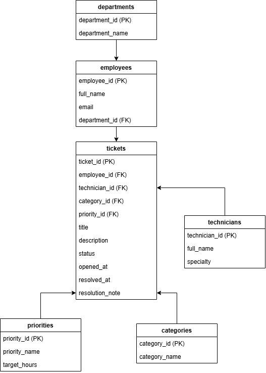
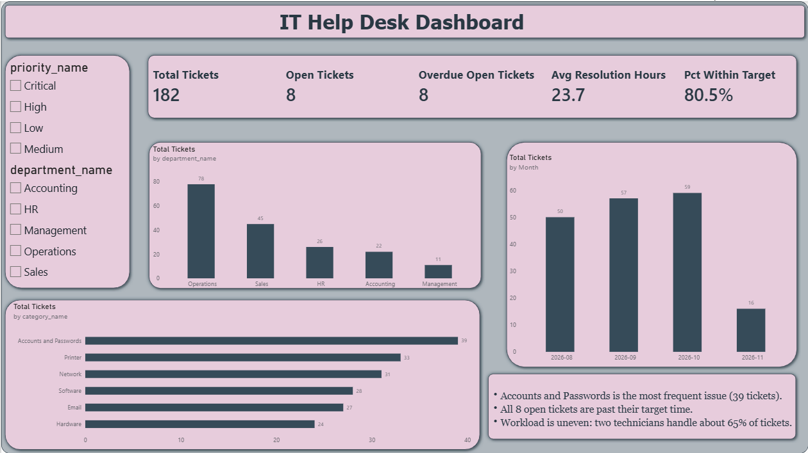
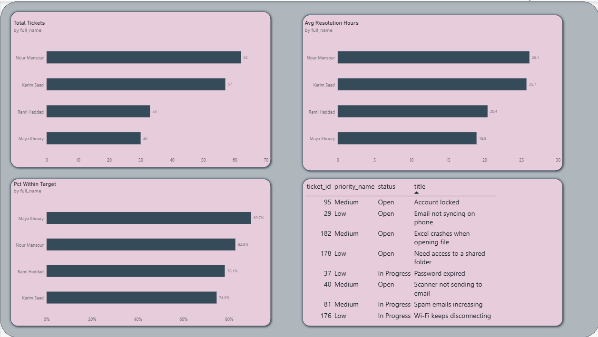

# IT Help Desk Management System

A personal MIS project: a ticket-tracking database and Power BI dashboard that help an IT team monitor support requests, overdue tickets, and technician workload.

**Author:** Celine Hashem | **Tools:** MySQL 8, Power BI, draw.io | **Type:** Personal project (fictional company, generated sample data)

## Overview

Cedar Trade Group is a fictional company with 60 employees and a 4-person IT team. Support requests arrive by email, phone, and WhatsApp, and nothing is tracked in one place. This project designs a central ticket system and gives management clear reports.

**What's inside:** requirements, a 6-table database with ERD, 182 sample tickets, 5 SQL queries, a 2-page Power BI dashboard, and 3 support procedures.

## Database

## Dashboard

## Key Findings

- Accounts and Passwords is the most frequent issue (39 tickets) and the slowest to resolve (33.6 hours on average).
- 80.5% of resolved tickets met their target time.
- All 8 open tickets are past their target time.
- Two technicians handle about 65% of all tickets.

**Recommendations:** add self-service password resets, review overdue tickets weekly, and balance technician workloads.

## Files

| File | Description |
|---|---|
| `Requirements.docx` | Project requirements |
| `schema.sql` | Creates the database and tables |
| `sample_data.sql` | Loads the sample data |
| `queries.sql` | 5 analysis queries |
| `insights.docx` | Findings from each query |
| `help_desk_dashboard.pbix` | Power BI dashboard |
| `procedures.docx` | Ticket handling procedures |

## How to Run

1. Run `schema.sql` in MySQL Workbench.
2. Run `sample_data.sql` once.
3. Run the queries in `queries.sql`, then open the `.pbix` file and connect it to your local `help_desk` database.

## Limitations

- All company and ticket data is fictional and generated for this project.
- Resolution time is counted in calendar hours, not working hours.
- November 2026 is a partial month (data ends November 6).
